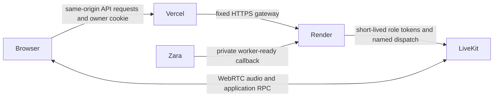

# Complete FoodEase hosting after the Cloud worker deployment

The frontend is `https://food-ease-seven.vercel.app`. Its currently deployed HTML
still points voice requests to `http://127.0.0.1:8090`. That cannot reach a hosted
backend from a visitor's device. This change supplies the missing production path:



Vercel serves the existing design and a stateless gateway. Render runs the existing
cart authority and session/token API together in one process. Zara runs separately
on LiveKit Cloud. Provider keys are never needed by the browser or the Render service.

## 1. Make the new source available to Render and Vercel

Commit and push the reviewed changes to the Git repository/branch connected to the
FoodEase Vercel project. The Cloud build already uses local source directly, so a
Cloud deployment does not publish these changes to your Git repository or Vercel.

The backend requires the repository root: `contracts/`, `website/`, `orchestration/`,
`deployment/backend.Dockerfile`, `render.yaml` and `zainab-pack/catalog-seed.json`.
Keep private `.env` files ignored. Do not paste credentials into Git, Docker build
arguments, chat, frontend variables or screenshots.

## 2. Create the Render backend

In the Render dashboard select **New → Web Service**, connect this repository, and
choose the branch containing the new code. A Blueprint deployment can alternatively
use the supplied `render.yaml`.

| Render field | Value |
|---|---|
| Name | `foodease-backend` (or your own available name) |
| Runtime | **Docker** |
| Root Directory | Leave blank: repository root |
| Dockerfile Path | `deployment/backend.Dockerfile` |
| Docker Build Context | `.` |
| Region | Singapore, as configured in the Blueprint |
| Instance count | **1** |
| Health Check Path | `/healthz` |
| Port | `10000` |
| Plan | An always-on plan; the Blueprint selects Starter. Review the charge in Render before creating it. |

The Dockerfile supplies the command. Do not add multiple Uvicorn workers or replicas.
The backend intentionally loads the existing website package in editable mode inside
the image so its template/static paths resolve to the copied application directories.

Under **Environment**, add:

| Name | Value/source | Classification |
|---|---|---|
| `LIVEKIT_URL` | FoodEase's existing local value; select the FoodEase project in LiveKit Settings → API keys. Currently `wss://foodease-nb0qr57x.livekit.cloud` | Server configuration, not a secret |
| `LIVEKIT_API_KEY` | Existing FoodEase `.env` / that project's API keys page | Server credential; keep private |
| `LIVEKIT_API_SECRET` | Matching existing FoodEase secret / API keys page | **Secret** |
| `CORS_ORIGINS` | `https://food-ease-seven.vercel.app` | Nonsecret server configuration |
| `FOODEASE_AGENT_NAME` | `foodease` | Nonsecret server configuration |
| `LIVEKIT_AGENT_DISPATCH` | `true` | Nonsecret server configuration |
| `FOODEASE_LEGACY_DEV_API` | `false` | Nonsecret server configuration |
| `PORT` | `10000` | Nonsecret server configuration |

Do **not** set `FOODEASE_BACKEND_URL` on Render: that belongs only on Vercel, and
the backend refuses it to prevent a proxy loop. No Groq or Cartesia key belongs here.

Deploy and wait until Render marks the service live. Copy the **actual assigned**
`https://...onrender.com` URL; do not assume the desired service name was available.
Open `<actual-url>/healthz`. Expected JSON includes:

```json
{"status":"ok","service":"foodease-backend","session_storage":"single_process"}
```

The backend is a long-running service, not durable order storage. Existing demo carts,
receipts and voice generations expire on process restart, and the application reports
expired attachments rather than inventing recovery or repeating writes. Keep one
instance/worker. Durable recovery and horizontal scaling require a transactional
shared store before they can be supported. Checkout remains a simulated demo.

## 3. Connect Zara to the actual Render URL

From the repository root, run this with the real Render origin:

```powershell
.\voice-agent\.venv\Scripts\python.exe deployment/cloud.py configure-backend --backend-url https://YOUR-ACTUAL-SERVICE.onrender.com
.\voice-agent\.venv\Scripts\python.exe deployment/cloud.py status
.\voice-agent\.venv\Scripts\python.exe deployment/cloud.py logs
```

The helper loads the existing private local configuration without printing it,
selects the FoodEase project explicitly and updates the same agent in `livekit.toml`.
It sets:

```text
FOODEASE_SESSION_API=https://YOUR-ACTUAL-SERVICE.onrender.com/assist
```

LiveKit secret updates trigger a rolling restart. Until this public callback is
configured, the Cloud worker rejects integrated jobs rather than calling localhost
or falling back to a mock cart. Do not create another Cloud agent for this step.

Cloud supplies `LIVEKIT_URL`, `LIVEKIT_API_KEY` and `LIVEKIT_API_SECRET` automatically.
The local deployment helper supplies the provider keys and selected runtime settings
through a temporary secrets file outside the upload context. Do not upload LiveKit
credentials as custom Cloud secrets. The dispatch name remains **`foodease`**.

## 4. Configure the Vercel frontend

Open **Vercel → FoodEase project → Settings → Environment Variables**. Add:

| Exact name | Value | Classification |
|---|---|---|
| `FOODEASE_BACKEND_URL` | The actual Render HTTPS origin, without a trailing path | Nonsecret, **server-side** gateway configuration |
| `ORCHESTRATION_BASE_URL` | `/assist` | Nonsecret; the relative path is intentionally visible in the page |
| `ENABLE_MOCK_AGENT` | `false` | Nonsecret server configuration |

Do not use `NEXT_PUBLIC_` or `VITE_` names. This is the existing Python/FastAPI
frontend, not a Next.js token implementation. **No LiveKit API secret, Groq key or
Cartesia key is required on Vercel** with this architecture. Existing `/assist/v2/*`
endpoints issue scoped tokens on Render using the original owner/session guards.

Select **Production** for the three variables. Add them to **Preview** only if you
intend to test a Preview deployment; then add that exact Preview origin to Render's
comma-separated `CORS_ORIGINS`. Do not use `*` with credentialed requests. Local
development can continue using the original local services with these production
gateway variables unset.

After the new source is available and variables are saved, open **Deployments →
latest Production deployment → Redeploy**. Environment changes do not change an
already deployed build. Preserve the project's working Python runtime/root settings;
do not switch it to a Next.js preset. Ensure its monorepo build includes the sibling
`contracts` package, as the existing relative dependency requires.

After redeployment the page must contain `data-orchestration-url="/assist"`, and API
requests must go to the same Vercel origin. The gateway forwards only FoodEase's owner
cookie and allowlisted headers, never Vercel authentication cookies or arbitrary
forwarding headers. It rejects cross-origin writes, upstream redirects and oversized
bodies, disables caching, and does not automatically retry cart mutations.

## 5. Final live acceptance after hosting

1. On the Vercel site, add an item manually and open the cart. Verify count and total.
2. Start Zara with the accessible voice control; allow the microphone and playback.
3. Ask for categories, drinks below 500, one verified product and the actual total.
4. Correct a quantity, interrupt a reply and ask another question. Check the real cart.
5. Open checkout and review it. Do not submit a real purchase; this application is demo-only.
6. End assistance and verify the microphone stops. Start again and verify the cart remains.
7. Test a short network interruption. The existing recovery path must use fresh context
   and must not repeat a cart write or create a second generation.
8. Inspect `deployment/cloud.py logs` for startup/provider errors and
   `foodease_stage_metrics`. SDK stage times are not listener-heard latency.

A real fluent-speaker/device session is still necessary for Urdu pronunciation,
naturalness, acoustic echo/false wakes, interruption comfort and screen-reader usability.
The synthetic local provider probe is useful evidence, not a replacement for these checks.

## 6. Groq capacity needs attention

The live probe reached this account's **8,000-token-per-minute** limit and received
HTTP `429` during consecutive turns. Hosting the worker will not increase that limit.
Use Groq Console → Limits/Billing for this same project/account to obtain sufficient
capacity, or configure a suitable key with higher approved limits. Review any charge
yourself; no account plan was changed. Re-run the consecutive-turn test afterward.

The worker retains the existing bounded retry and Urdu rate-limit recovery. Provider
failure cannot turn an uncertain cart action into a success announcement or a blind retry.

The model also asked an unnecessary quantity question despite hearing one item.
Explicit Urdu quantity guidance was strengthened, but the retest still did not add
the item. Live shopping-language acceptance remains open; Running status and a short
synthetic clarification timing do not establish reliable voice ordering.

## 7. Keep the worker warm while resetting conversations

Stopping Zara or refreshing the page ends only that visitor's assistance generation.
It releases microphone/audio, room and dispatch. The shared Cloud worker is not stopped.
Refresh starts a fresh introduction and mode choice while retaining the cart; starting
voice or wake recognition still requires explicit activation.

Cloud prewarming is already enabled. The inspected deployment reports one replica and
minimum one, but this alone does not guarantee indefinite idle uptime: LiveKit's current
Build/free plan can scale production agents to zero. Supported paid production plans
keep agents warm. Confirm the FoodEase plan in LiveKit's dashboard if continuously warm
hosting is required; no subscription was changed by this work. Do not hold a microphone
or fake session open as a keepalive. See the
[lifecycle audit](../website/docs/ZARA_LIFECYCLE_AUDIT_2026-11-08.md) and
[official cold-start policy](https://docs.livekit.io/deploy/agents/managing-deployments/).

References checked:
[LiveKit deployment](https://docs.livekit.io/deploy/agents/quickstart/),
[Cloud secrets](https://docs.livekit.io/deploy/agents/secrets/),
[Render Docker services](https://render.com/docs/docker),
[Vercel environments](https://vercel.com/docs/deployments/environments),
[Vercel environment settings and redeployment](https://vercel.com/academy/vercel-foundations/vercel-settings),
[Groq limits](https://console.groq.com/docs/rate-limits).
